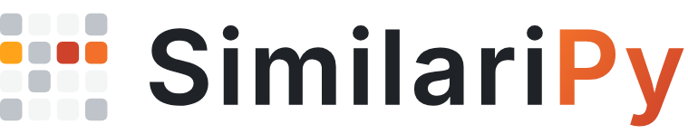

<p align="center">
  
</p>

# SimilariPy

[](https://pypi.org/project/similaripy/)
[](https://bogliosimone.github.io/similaripy/)
[](https://github.com/bogliosimone/similaripy/actions/workflows/python-package.yml)
[](https://github.com/bogliosimone/similaripy/actions/workflows/pypi-publish.yml)
[](https://github.com/bogliosimone/similaripy/actions/workflows/deploy-docs.yml)
[](https://pypi.org/project/similaripy/)
[](https://github.com/bogliosimone/similaripy/blob/master/LICENSE)
[](https://doi.org/10.5281/zenodo.2583851)


SimilariPy is a high-performance Python package, built in Rust, to compute KNN similarity matrices from sparse data and serve them with low latency.

It also includes normalization functions to pre-process the data.

SimilariPy is primarily designed for Recommender Systems and Information Retrieval (IR) tasks, but can be applied to other domains as well.

The official documentation is available at **[📘 SimilariPy Guide](https://bogliosimone.github.io/similaripy/)**

## 🔍 Similarity Functions

SimilariPy provides a range of high-performance similarity functions for sparse matrices.  
All functions run in a multi-threaded Rust core, GIL-free, on sparse CSR matrices.

### Core 

- **Dot Product**: Simple raw inner product between vectors.
- **Cosine**, **Asymmetric Cosine**: Normalized dot product, symmetric or skewed by `alpha`.
- **Jaccard**, **Dice**, **Tversky**: Set-based generalized similarities.

### Graph-Based

- **P3α**: Graph-based similarity computed through random walk propagation with exponentiation.
- **RP3β**: Similar to P3α but includes popularity penalization using a `beta` parameter.

### Advanced 

- **S-Plus**: A hybrid model combining Tversky and Cosine components, with RP3Beta-style depopularization and full control over weights and smoothing.

For more details, check the **[📘 Similarities](https://bogliosimone.github.io/similaripy/similarity/)** guide.

## 🛎️ Serving

The serving engine runs item-based KNN models online, in your own item ids:

- **Fast**: recommendations in tens to hundreds of microseconds, GIL-free; many users in parallel.
- **Multi-process**: save once, load memory-mapped in every worker: one copy of the model for all of them.
- **Availability rules**: include or exclude items for all requests, per group (e.g. a country, then a package) or per request.

For more details, check the **[📘 Serving](https://bogliosimone.github.io/similaripy/serving/)** guide.

## 🧮 Normalization and Weighting

Re-weight your data before the similarity computation: normalization functions on sparse matrices (multi-threaded Rust core, GIL-free, a new CSR matrix: the input never changes), and time decay of interactions.

- **L1, L2**: Applies row- or column-wise normalization.
- **TF-IDF**: Computes TF-IDF weighting with customizable term-frequency and IDF modes.
- **BM25**: Applies classic BM25 weighting used in information retrieval.
- **BM25+**: Variant of BM25 with additive smoothing for low-frequency terms.
- **Time and rank decay**: weight each interaction by its age or recency.

For more details, check the **[📘 Normalizations](https://bogliosimone.github.io/similaripy/normalization/)** and **[📘 Preprocessing](https://bogliosimone.github.io/similaripy/preprocessing/)** guides.

## ⚡ Performance

- **Rust core**: native code, multi-threaded with rayon, GIL-free
- **Gustavson's row-wise product + cache blocking**: a dense accumulator per row, kept in the CPU cache by cache-sized column tiles
- **Memory-efficient**: float32 values, int32 indices, pre-allocated buffers, top-k heap per row

## 🚀 Getting Started

From an interaction log to recommendations:

```python
import similaripy as sim
from similaripy.preprocessing import interactions_to_histories, interactions_to_urm
from similaripy.serving import ItemKNN

# An interaction log: one (user, item) pair per event, in your own ids
users = [10, 10, 10, 20, 20, 20, 30, 30, 30, 40, 40, 50, 50]
items = [101, 102, 103, 101, 103, 104, 102, 103, 105, 101, 104, 102, 105]

# The user-item matrix (URM), with the id maps: row u is user_ids[u], column j is item_ids[j]
# (older events can count less: see time_decay in Preprocessing)
urm, user_ids, item_ids = interactions_to_urm(users, items)

# Train an item-item cosine similarity model
similarity_matrix = sim.cosine(urm.T, k=50)

# Build the serving model, in your item ids
model = ItemKNN(similarity_matrix.T, item_ids=item_ids)

# Online: a user from the items they interacted with (no retraining), already-seen items excluded
ids, scores = model.recommend([101, 104], k=3)
print(ids)  # [103 102]: item ids from the log

# Offline: every user of the log at once, e.g. to evaluate a model
user_ids, histories, weights = interactions_to_histories(users, items)
ids, scores = model.recommend_batch(histories, weights=weights, k=3)
```

For a more in-depth, end-to-end example with SimilariPy, see the notebook:
**[MovieLens 32M Item-Item Recommender](https://github.com/bogliosimone/similaripy/blob/master/notebooks/movielens32m_item_item_recommender.ipynb)**.

## 📦 Installation

SimilariPy can be installed from PyPI with:

```cmd
pip install similaripy
```

Pre-built wheels are available for Python 3.11 to 3.15 on:

- Linux x86_64 and aarch64 (glibc 2.28+, or musl 1.2+ e.g. Alpine)
- macOS 12+ (Apple Silicon) and 10.15+ (Intel)
- Windows x64

No compiler is needed on these platforms. Elsewhere, pip builds the package from source, which needs a Rust toolchain: see **[Build from source](https://bogliosimone.github.io/similaripy/installation/#build-from-source)**.

Free-threaded Python (3.14t, 3.15t) is supported: the GIL stays disabled. Calls from several Python threads share one thread pool by default and queue on it; `num_threads=n` gives each calling thread its own pool of `n` threads.

## 📦 Requirements

| Package                         | Version        |
| --------------------------------|:--------------:|
| python                          |   >= 3.11      |
| numpy                           |   >= 1.23.5    |
| scipy                           |   >= 1.15.0    |

## 📜 History

This library originated during the **[Spotify Recsys Challenge 2018](https://research.atspotify.com/publications/recsys-challenge-2018-automatic-music-playlist-continuation/)**.

Our team, The Creamy Fireflies, faced major challenges computing large similarity models on a dataset with over 66 million interactions. Standard Python/Numpy solutions were too slow as a whole day was required to compute one single model.

To overcome this, I developed high-performance versions of the core similarity functions in Cython and OpenMP. Encouraged by my teammates, I open-sourced this work to help others solve similar challenges. For 1.0 the core was rewritten in Rust.

Thanks to my Creamy Fireflies friends for the support! 🙏 

## 📄 License

This project is released under the MIT License.

## 🔖 How to cite

If you use SimilariPy in your research, please cite it (GitHub's "Cite this repository" gives the same entry in other formats):

```text
@software{boglio_similaripy,
  author = {Boglio, Simone},
  title  = {SimilariPy},
  doi    = {10.5281/zenodo.2583851},
  url    = {https://github.com/bogliosimone/similaripy}
}
```
