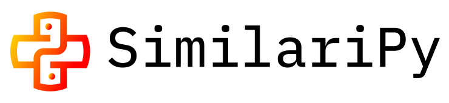

# 

## Welcome to SimilariPy’s documentation!

**SimilariPy** is a high-performance Python package, built in Rust, to compute KNN similarity matrices from sparse data and serve them with low latency.

---

## 🔥 Why SimilariPy?

- **Wide similarity coverage**: Dot Product, Cosine, Tversky, P3α, RP3β, and more.
- **Low-latency recommendations**: serving in under a millisecond, one model shared by all workers.
- **Availability rules**: include or exclude items for every request, a group of users or one user.
- **Normalization and weighting**: L1, L2, TF-IDF, BM25, BM25+, time/rank-based decay.
- **Fast**: a multi-threaded Rust core, GIL-free.
- **Sparse matrix focus**: any SciPy sparse input, CSR or COO output.

---

## 📚 Guide

- [Installation](installation.md)
- [Quickstart](guide.md)
- [Similarities](similarity.md)
- [Serving](serving.md)
- [Normalizations](normalization.md)
- [Signed Input](signed-input.md)
- [API reference](api/similarity.md)
- [Migration from 0.7.0](migration.md)

---

## ⚡ Key Performance Optimizations

SimilariPy achieves high performance through several key optimizations:

- **Gustavson's row-wise sparse product**: each output row's scores add up in a dense accumulator, and only the touched columns are read back, with no hashing
- **Rust core**: native code, multi-threaded with rayon, GIL released during the computation
- **Cache blocking**: the output columns are split into cache-sized tiles, most popular first, so the accumulator stays in the CPU cache on large matrices
- **Specialized scoring**: one compiled loop per scoring mode, with no per-candidate branches; cosine and RP3β run as a plain dot product of pre-scaled inputs
- **Compact types**: float32 values and int32 indices, half the memory traffic of float64/int64
- **Pre-allocated buffers**: per-thread accumulators and heaps reused across rows, no allocation per row
